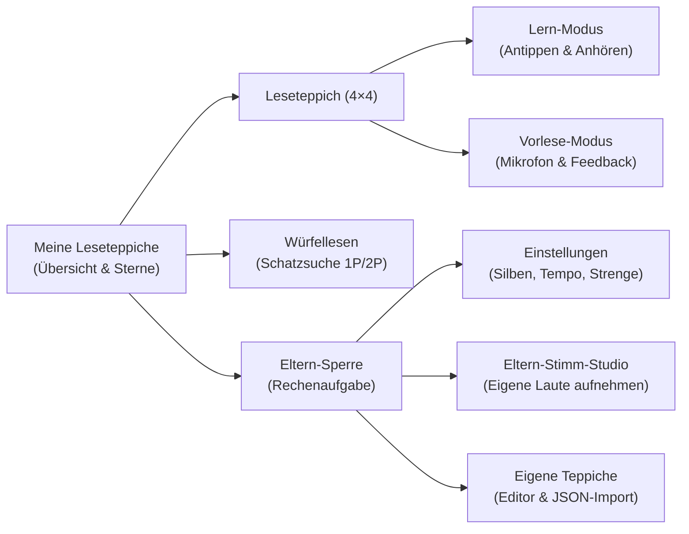

# Konzept: Leseteppich – Leseflüssigkeits-App für die 1. Klasse

## 1. Idee & Pädagogisches Ziel

**Leseteppiche** sind ein bewährtes Werkzeug aus dem deutschen Anfangsunterricht (1. Klasse), um die **Lautsynthese** (Zusammenziehen einzelner Laute zu Silben und Wörtern) und die **Leseflüssigkeit** durch gezielte Wiederholung zu trainieren:

1. **Kumulativer Buchstabenaufbau**: Jeder Leseteppich führt genau einen neuen Laut ein (z. B. Teppich 1: `N, I, A` → Teppich 2: `+ O` → Teppich 3: `+ T` → Teppich 4: `+ M` → Teppich 5: `+ L` → Teppich 6: `+ S` → Teppich 7: `+ E` → Teppich 8: `+ P` usw.).
2. **4×4-Progression**: Ein Teppich besteht aus 16 Feldern, die von oben links nach unten rechts schwieriger werden:
   - Zeile 1: Einzellaute und offene Kernsilben (`a`, `i`, `n`, `an`)
   - Zeile 2: Kurze Silbenkombinationen (`in`, `na`, `ni`, `ma`)
   - Zeile 3: Zweisilbige Wörter & Namen (`Ni|na`, `Ma|ma`, `La|ma`, `E|sel`)
   - Zeile 4: Längere 2- bis 3-silbige Wörter & Quatschwörter (`To|ma|te`, `A|ni|na`, `O|na|no`), damit Kinder wirklich erlesen statt auswendig zu raten.
3. **Silbenmethode (Silbenschrift & Silbenbögen)**:
   - Mehrsilbige Wörter werden zweifarbig hervorgehoben (Blau / Korallrot).
   - Optional werden **Silbenbögen** unter jeder Silbe angezeigt – genau wie Kinder sie im Unterricht mit Bleistift einzeichnen.
4. **Wiederholung & Motivation („So oft habe ich gelesen“)**:
   - Jeder Teppich besitzt 5 Abhak-Kästchen / Sterne.
   - Auf der Übersichtskarte **„Meine Leseteppiche“** füllt sich jedes Motiv (Ameise, Oma, Tasse, Maus, Löwe, Sonne, Esel, Pinsel, …) mit jedem Durchgang.
5. **Bonusspiel „Würfellesen – Schatzsuche“**:
   - 6 Spalten (Würfelaugen 1–6) führen von unten (leicht: Einzelsilbe) nach oben (schwieriger: kurze Wörter, erste Sätze mit Bildwörtern/Rebus wie `Tim ❤️ Salat.` oder `Oli ist im 🛏️`, dreisilbige Leserhythmen) zu einer Schatztruhe.
   - Spielbar allein oder zu zweit (z. B. Kind gegen Mama/Papa).

---

## 2. Nutzerführung & Modi



### Kindgerechtes UX-Prinzip: **Frustfrei lernen**
- Große, ruhige Typografie (abgerundete Schrift, hohe Kontraste, keine Werbung, keine Ablenkungen).
- **Keine harten Fehler-Geräusche**: Wird ein Laut nicht erkannt, ermutigt die App freundlich („Probier es noch einmal!“), bietet direktes Vorlesen an und blendet bei Bedarf eine unaufdringliche **„Richtig gelesen ✓“**-Hilfe ein.
- **Einzelsilben-Hilfe**: Tippt das Kind in der Fokus-Karte direkt auf eine einzelne Silbe (z. B. `To` oder `ma` oder `te`), wird genau diese Silbe langsam vorgesprochen.

---

## 3. Technische Kernherausforderungen & Lösungsarchitektur

### Herausforderung A: Lautsprache statt Buchstabennamen (Vorlesen / TTS)

Im 1. Schuljahr lernen Kinder **Laute**, nicht Buchstabennamen:
- `n` wird als gedehntes **„nnn“** gelesen, nicht als *„Enn“*.
- `m` wird als **„mmm“** gelesen, nicht als *„Emm“*.
- `s` wird als **„sss“** gelesen, nicht als *„Ess“*.
- Standard-TTS-Stimmen lesen isolierte Einzelbuchstaben oft fälschlicherweise als Buchstabennamen oder stolpern über Quatschwörter (`Onano`, `Mosi`).

**Zweistufige Hybrid-Lösung:**
1. **Stufe 1 – Eltern-Stimm-Studio (höchste Qualität)**:
   - Eltern können für jedes Feld (besonders für die wenigen Einzellaute `a, i, n, o, t, m, l, s, e, p`) in Sekunden eine eigene `.m4a`-Aufnahme einsprechen.
   - Existiert eine eigene Aufnahme für eine Feld-ID (`tile.id`), spielt die App automatisch diese vertraute Stimme statt TTS ab.
2. **Stufe 2 – IPA-gestützte Sprachsynthese**:
   - Jedes Feld im gemeinsamen JSON-Format enthält `spokenText` sowie optional `ipa` (International Phonetic Alphabet) und `isSinglePhoneme`.
   - Bei Einzellauten nutzt iOS `AVSpeechSynthesisIPANotationAttribute` (`NSAttributedString`), um den reinen Laut zu erzwingen; bei regulären Silben/Wörtern nutzt die App die hochwertigste installierte deutsche iOS-Stimme mit kindgerecht verlangsamtem Sprechtempo.

### Herausforderung B: Spracherkennung bei 6-Jährigen & kurzen Silben (ASR)

Allgemeine Spracherkenner (Apple `SFSpeechRecognizer`, Android `SpeechRecognizer`) sind auf Erwachsenensätze trainiert. Typische Probleme bei Erstklässlern:
- Homophone statt offener Silben: Kind sagt `ni` → ASR liefert `nie` oder `nee`; Kind sagt `Ti` → ASR liefert `die` oder `tea`.
- Zerlegte Wörter: `Nani` → `Na nie`; `Tomate` → `To mate`.
- Leichte Stimmhaftigkeits-Vertauschungen bei Kindern (`t`/`d`, `p`/`b`, `s`/`z`).
- Sehr kurze isolierte Konsonanten (`t`, `n`) werden von Wort-ASR oft ignoriert.

**Dreistufige Erkennungs-Pipeline:**
1. **On-Device ASR mit Vokabular-Hinweisen**:
   - `SFSpeechRecognizer(locale: "de-DE")` mit `requiresOnDeviceRecognition = true` (wenn unterstützt) – **keine Kinderstimmen verlassen das Gerät (DSGVO-freundlich!)**.
   - `contextualStrings` werden dynamisch mit allen Silben, Wörtern und Varianten des aktuellen Leseteppichs gefüttert.
   - Auswertung **aller** Hypothesen (`result.transcriptions`), nicht nur des ersten Treffers.
2. **Plattformunabhängiger `PhoneticMatcher` (Domain-Layer)**:
   - Exakter Vergleich (inkl. Zusammenschreiben getrennter Silben wie `Na nie` → `nanie`).
   - Deutsche Phonetik-Normalisierung (`ie/ih → i`, `ah → a`, `ß → s`, Doppelkonsonanten `ss/tt/ll/nn → s/t/l/n`).
   - Explizite `acceptedTranscriptions` pro Kachel (inkl. Rebus-Varianten wie `Tim mag Salat` / `Tim liebt Salat`).
   - Konfigurierbare Strenge (**Sanft / Normal / Genau**): Im sanften Anfängermodus werden kindertypische Lautpaare (`t/d`, `p/b`, `s/z`) sowie moderate Levenshtein-Abweichungen bei längeren Wörtern toleriert.
3. **Ausblick Phase 2 (Noch präzisere Lauterkennung)**:
   - iOS 17+ `SFSpeechLanguageModel` (maßgeschneidertes lokales Sprachmodell für den 1.-Klasse-Wortschatz).
   - Optionales On-Device-Phonemmodell via **ONNX Runtime** (z. B. kompaktes deutsches wav2vec2/Sherpa-ONNX-Phonemmodell) – läuft identisch auf iOS und Android und erkennt selbst isolierte Einzellaute (`n`, `s`, `m`, `l`, `t`) zuverlässig!

---

## 4. Plattformübergreifende Architektur (iOS → Android)

Die App ist bewusst so geschnitten, dass ein späterer nativer Android-Port (Kotlin + Jetpack Compose) ohne Neuentwurf gelingt:

```
shared/                     <-- 100 % gemeinsame Wahrheit für iOS & Android
├── schema/                 <-- JSON-Schema für Leseteppiche & Würfellesen
├── content/                <-- leseteppiche.json, wuerfellesen.json
└── test-vectors/           <-- phonetic_matching.json (identische Tests für Swift & Kotlin)

ios/Leseteppich/
├── Domain/                 <-- Reines Swift (nur Foundation), 1:1 übertragbar nach Kotlin
│   ├── Models/             <-- Carpet, ReadingTile, DiceBoard, AppSettings
│   └── Engine/             <-- PhoneticMatcher, ReadingSessionEngine, DiceGameEngine
├── Services/               <-- Protokoll-Adapter (AVSpeech, SFSpeech, AVAudioRecorder, JSON Store)
└── Features/               <-- SwiftUI Views (1:1 Mapping zu Jetpack Compose Screens)
```

Details zur 1:1-Übertragung nach Kotlin/Compose stehen in [ANDROID_PORTING.md](ANDROID_PORTING.md).

---

## 5. Datenschutz & Urheberrecht

- **Datenschutz**: Alle Daten (Fortschritt, eigene Teppiche, Eltern-Aufnahmen) bleiben ausschließlich lokal auf dem Gerät. Es gibt kein Tracking, keine Analytics, keinen Login und keine Werbung.
- **Urheberrecht**: Arbeitsblätter aus dem Schulalltag (z. B. von kommerziellen Grundschul-Verlagen) dürfen nicht unverändert in einem öffentlichen GitHub-Repository veröffentlicht werden. Das öffentliche Repository enthält daher **eigene, frei lizenzierte (MIT) Leseteppiche** nach derselben 1.-Klasse-Progression (`N/I/A → O → T → M → L → S → E → P`) sowie ein eigenes Würfellesen-Brett. Über den integrierten **Eltern-Editor** oder den **JSON-Import** lassen sich beliebige schuleigene Leseteppiche privat und lokal auf dem Gerät der Tochter ergänzen.

---

## 6. Roadmap

| Phase | Umfang | Status |
|---|---|---|
| **Phase 1 (MVP – iOS)** | 8 Leseteppiche (`N/I/A`–`P`), Silbenschrift & Silbenbögen, Würfellesen (1P/2P + Rebus), On-Device ASR + `PhoneticMatcher`, IPA-TTS, Eltern-Stimm-Studio, Custom-Editor & JSON-Import, GitHub Actions CI + TestFlight | **Umgesetzt** |
| **Phase 2 (Feinschliff)** | Weitere Leseteppiche bis Teppich 20 (`W, R, Ei, H, U, F, K, B, Z, Au, Ch, Sch`), `SFSpeechLanguageModel` (iOS 17+), Export/Share eigener Teppiche per AirDrop, optionales ONNX-Phonemmodell für Einzellaute | Geplant |
| **Phase 3 (Android)** | Natives Android-Modul unter `android/` (Kotlin, Jetpack Compose, gleicher `shared/`-Content & Test-Vektoren) | Vorbereitet |
